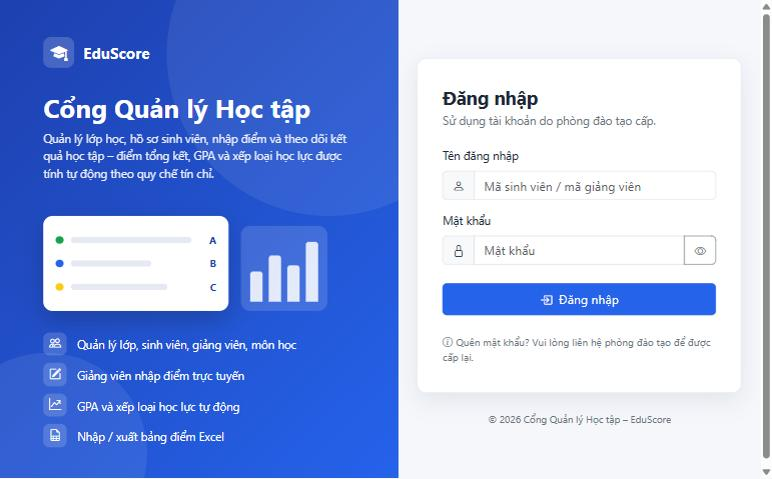
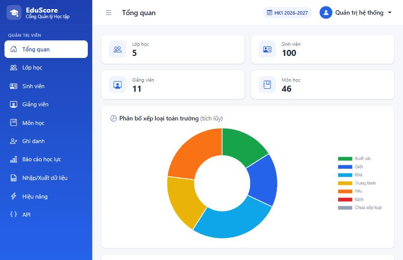
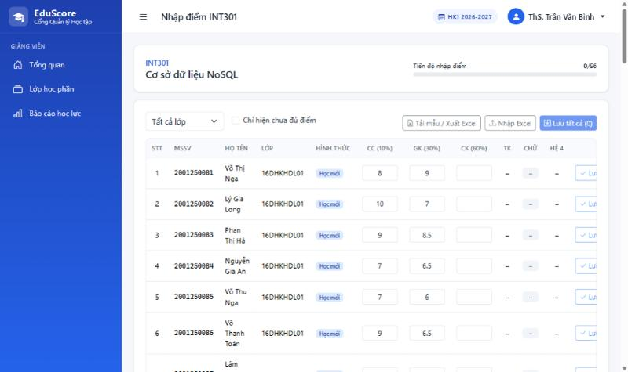
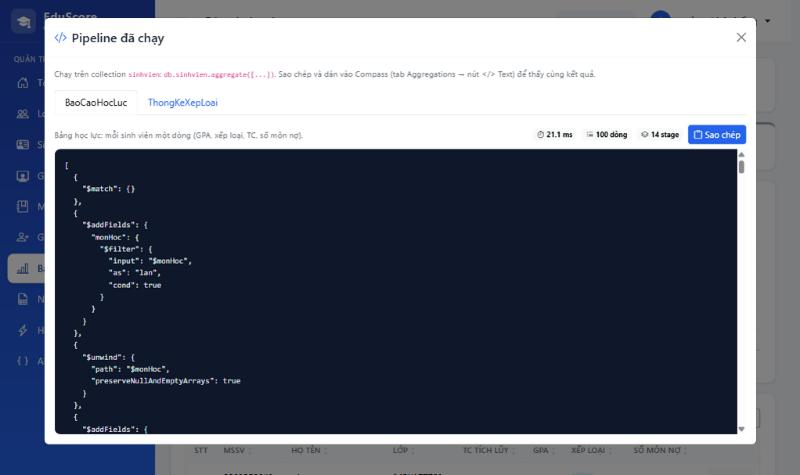
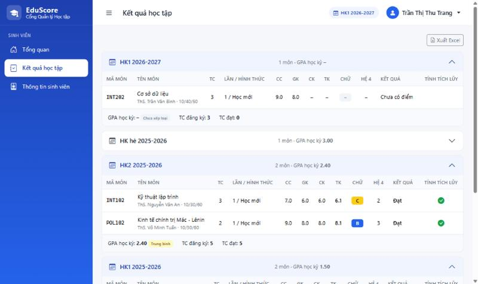
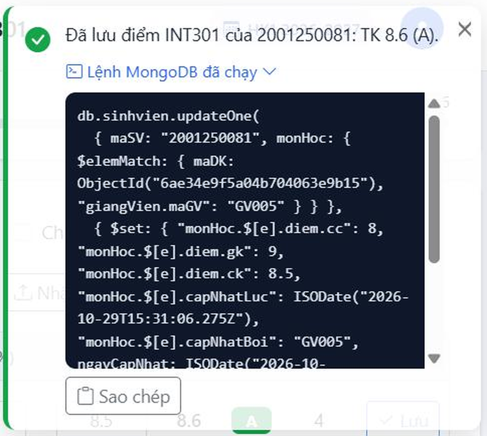

# EduScore – Cổng Quản lý Học tập

> **Đồ án môn NoSQL – Đề tài 02: Hệ thống quản lý và chấm điểm học tập trực tuyến** · Nhóm 6

EduScore là cổng quản lý **kết quả học tập** bậc đại học (giống cổng sinh viên của trường): quản lý lớp sinh hoạt, hồ sơ sinh viên, ghi danh môn học, giảng viên nhập điểm thành phần, và **tính điểm tổng kết, GPA hệ 4, xếp loại học lực hoàn toàn bằng MongoDB Aggregation Pipeline**.

Điểm nhấn về NoSQL:
- Mỗi hồ sơ sinh viên là **một document** nhúng mảng `monHoc` (mỗi phần tử = một lần học: tín chỉ, giảng viên, trọng số, điểm CC/GK/CK) – đọc trọn hồ sơ trong một lần truy vấn.
- Ghi trên mảng lồng: ghi danh `$push`, hủy ghi danh `$pull`, nhập điểm `$set` + `arrayFilters` (quyền của giảng viên nằm ngay trong `arrayFilters`), lan truyền tên `updateMany` + `arrayFilters`.
- Không lưu điểm tổng kết / GPA / xếp loại: mọi con số đều do pipeline (`$unwind`, `$group`, `$project`, `$cond`, `$switch`, `$setWindowFields`) tính lại từ điểm thành phần.
- Mỗi thao tác ghi hiện **toast kèm câu lệnh MongoDB đã chạy** (dạng mongosh) để đối chiếu trong Compass.

---

## Ảnh chụp màn hình

> Đặt ảnh vào `docs/images/` theo đúng tên file bên dưới (xem [`docs/images/README.md`](docs/images/README.md)).

| Đăng nhập | Tổng quan Admin |
|---|---|
|  |  |
| **Nhập điểm (giảng viên)** | **Báo cáo học lực + Xem pipeline** |
|  |  |
| **Kết quả học tập (sinh viên)** | **Toast lệnh MongoDB / Compass** |
|  |  |

---

## Công nghệ

| Thành phần | Công nghệ |
|---|---|
| Ứng dụng web | ASP.NET Core MVC (.NET 9, C#), Razor render phía server, 3 Area: `Admin`, `GiangVien`, `SinhVien` |
| Cơ sở dữ liệu | MongoDB 8 (standalone), MongoDB.Driver 3.13 – validator `$jsonSchema`, index, Aggregation Pipeline |
| Xác thực | Cookie Authentication, mật khẩu băm BCrypt (BCrypt.Net-Next) |
| Excel | ClosedXML (nhập danh sách SV, nhập/xuất bảng điểm, xuất báo cáo) |
| Giao diện | Bootstrap 5, Bootstrap Icons, Chart.js – để cục bộ trong `wwwroot/lib` (**không dùng CDN**, chạy được khi mất mạng) |
| API (tùy chọn) | REST `/api/...` + Swagger UI (Swashbuckle) ở môi trường Development |

---

## Yêu cầu cài đặt

| Phần mềm | Phiên bản | Ghi chú |
|---|---|---|
| [.NET SDK](https://dotnet.microsoft.com/download/dotnet/9.0) | 9.0 | Kiểm tra: `dotnet --version` |
| [MongoDB Community Server](https://www.mongodb.com/try/download/community) | 8.0 trở lên | Chạy ở `mongodb://localhost:27017` (cài dạng Windows Service) |
| [MongoDB Compass](https://www.mongodb.com/try/download/compass) | tùy chọn | Xem document, chạy pipeline khi demo |
| [mongosh](https://www.mongodb.com/try/download/shell) | tùy chọn | Truy vấn bằng dòng lệnh |
| [MongoDB Database Tools](https://www.mongodb.com/try/download/database-tools) | tùy chọn | `mongodump` / `mongorestore` / `mongoimport` |

## Chạy ứng dụng

```bash
git clone <địa-chỉ-repo> DT2_LMS_NHOM6
cd DT2_LMS_NHOM6
dotnet run --project DT2_LMS_NHOM6
```

Mở trình duyệt: **http://localhost:5207**

- Lần chạy đầu, database `eduscore` trống → ứng dụng **tự tạo validator, index và dữ liệu mẫu** (100 sinh viên, 5 lớp, 8 giảng viên, 14 môn, 640 lần học). Không cần import gì.
- MongoDB chưa chạy → console báo `Không kết nối được MongoDB tại localhost:27017 ...` và thoát.
- Đổi chuỗi kết nối / tên database: sửa mục `MongoDB` trong `DT2_LMS_NHOM6/appsettings.json`, hoặc đặt biến môi trường `MongoDB__ConnectionString`, `MongoDB__DatabaseName`.
- Muốn khôi phục đúng bản dữ liệu đã nộp (cùng `_id`): xem [`database/README.md`](database/README.md).

## Tài khoản demo

| Vai trò | Tên đăng nhập | Mật khẩu | Ghi chú |
|---|---|---|---|
| Admin (phòng đào tạo) | `admin` | `Admin@123` | Toàn quyền |
| Giảng viên | `GV005` | `123456` | ThS. Trần Văn Bình – dạy **INT301 Cơ sở dữ liệu NoSQL** HK1 2026-2027 (dùng demo nhập điểm) |
| Giảng viên | `GV001` | `123456` | ThS. Nguyễn Văn An – dạy INT101, INT102; cố vấn học tập lớp 16DHTH01 |
| Giảng viên khác | `GV002` … `GV008` | `123456` | |
| Sinh viên TS1 | `2001250001` | `15032007` | Nguyễn Hoàng Minh – làm tròn nửa lên (8.45 → 8.5), GPA tích lũy 3.27 Giỏi |
| Sinh viên TS2 | `2001250002` | `22072007` | Trần Thị Thu Trang – học lại INT101 (F → B), 2.73 Khá |
| Sinh viên TS3 | `2001250003` | `09112007` | Lê Văn Phúc – cải thiện bị điểm thấp hơn (giữ lần cũ), 3.00 Khá |
| Sinh viên TS4 | `2001250004` | `01012007` | Phạm Gia Huy – nợ 2 môn, GPA HK2 0.60 Kém, 1.50 Yếu |
| Sinh viên TS5 | `2001250005` | `28052007` | Võ Ngọc Bảo Anh – biên Xuất sắc 3.60; có trong lớp INT301 của GV005 |

Mật khẩu mặc định: giảng viên `123456`; sinh viên = ngày sinh dạng `ddMMyyyy`. Kết quả mong đợi của TS1–TS5 (tính tay) và kết quả kiểm thử: [`docs/kiem-thu-gpa.md`](docs/kiem-thu-gpa.md).

## Lệnh dòng lệnh

| Lệnh | Tác dụng |
|---|---|
| `dotnet run --project DT2_LMS_NHOM6` | Chạy web tại http://localhost:5207 (DB trống → tự seed) |
| `dotnet run --project DT2_LMS_NHOM6 -- --reset` | Xóa database `eduscore`, tạo lại validator, index, dữ liệu mẫu rồi chạy web |
| `dotnet run --project DT2_LMS_NHOM6 -- --kiem-thu-gpa` | Chạy pipeline thật cho 5 SV kiểm thử, so với kết quả tính tay, ghi `docs/kiem-thu-gpa.md` rồi thoát (cần dữ liệu nguyên bản → dùng kèm `--reset`) |
| `dotnet run --project DT2_LMS_NHOM6 -- --export-pipelines` | Ghi mọi pipeline ra `database/pipelines/*.json` (dán vào Compass) rồi thoát |
| `dotnet run --project DT2_LMS_NHOM6 -- --export` | Ghi 5 collection ra `database/export/*.json` (+ `database/dump/eduscore.archive.gz` nếu có `mongodump`) rồi thoát |
| `dotnet run --project DT2_LMS_NHOM6 -- --reset --tao-file-demo` | Tạo lại các file Excel demo trong `docs/demo/` rồi thoát |
| `powershell -ExecutionPolicy Bypass -File database\khoi-phuc.ps1` | Khôi phục database từ `database/` |

Kiểm tra nhanh bằng mongosh:
```bash
mongosh eduscore --quiet --eval "db.sinhvien.countDocuments()"   # 100
```

## Cấu trúc thư mục

```
DT2_LMS_NHOM6/
├── README.md, CLAUDE.md, DT2_LMS_NHOM6.sln
├── docs/
│   ├── thiet-ke.md          Tài liệu thiết kế hệ thống (nghiệp vụ, quy tắc điểm, schema, màn hình)
│   ├── thiet-ke-csdl.md     Thiết kế CSDL: vì sao Document Store, JSON Schema, sơ đồ, index, pipeline, toán tử mảng
│   ├── kich-ban-demo.md     Kịch bản demo ~10 phút
│   ├── kiem-thu-gpa.md      Kết quả kiểm thử pipeline với 5 SV tính tay (200/200 PASS)
│   ├── demo/                File Excel mẫu cho demo nhập (hợp lệ / có lỗi)
│   ├── images/              Ảnh chụp màn hình
│   ├── bao-cao/             Báo cáo từng giai đoạn làm đồ án
│   └── quy-trinh/           Quy trình làm từng giai đoạn
├── database/
│   ├── export/*.json        Dữ liệu xuất 5 collection (Extended JSON)
│   ├── dump/                Bản mongodump (nếu có)
│   ├── pipelines/*.json     Aggregation Pipeline để dán vào Compass
│   └── khoi-phuc.ps1        Script khôi phục
└── DT2_LMS_NHOM6/           Project ASP.NET Core MVC
    ├── Areas/Admin|GiangVien|SinhVien/   Controller + View theo vai trò
    ├── Controllers/         Đăng nhập, trang lỗi, Api/ (REST)
    ├── Models/Documents/    Class ánh xạ document MongoDB
    ├── Models/Results/      Class nhận kết quả pipeline
    ├── Pipelines/           Pipeline viết bằng chuỗi JSON (QuyDoiDiemStages = bộ quy đổi dùng chung)
    ├── Services/            Nghiệp vụ (controller không gọi MongoDB trực tiếp)
    ├── Data/                MongoContext, DbInitializer (validator, index), Seeder, các lệnh dòng lệnh
    ├── Infrastructure/      Culture, phân quyền, MongoCommandFormatter (in lệnh mongosh cho toast)
    ├── ViewModels/, Views/
    └── wwwroot/             css, js, lib (Bootstrap, Bootstrap Icons, Chart.js)
```

## Mô hình dữ liệu (tóm tắt)

Database `eduscore`, 5 collection. Quy ước lớp: **`maLop` là mã nội bộ, `tenLop` là tên hiển thị**. Trên giao diện, Excel và lời nói đều dùng tên lớp (16DHTH01). Mã lớp (CNTT2501) chỉ hiện ở trang Lớp học và trong dữ liệu / lệnh MongoDB.

| maLop | tenLop |
|---|---|
| CNTT2501 | 16DHTH01 |
| CNTT2502 | 16DHTH02 |
| ATTT2501 | 16DHATTT01 |
| HTTT2501 | 16DHHTTT01 |
| KHDL2501 | 16DHKHDL01 |


| Collection | Nội dung | Quan hệ |
|---|---|---|
| `sinhvien` | Hồ sơ SV + **mảng `monHoc` nhúng** (mỗi phần tử: `maDK`, `maMon`, `tenMon`, `soTinChi`, `namHoc`, `hocKy`, `lanHoc`, `hinhThuc`, `giangVien {maGV, hoTen}`, `trongSo {cc,gk,ck}`, `diem {cc,gk,ck}`, `capNhatLuc`, `capNhatBoi`) | `maLop` → `lophoc`; `monHoc[].maMon` → `monhoc`; `monHoc[].giangVien.maGV` → `giangvien` |
| `lophoc` | Lớp sinh hoạt: `maLop` là mã nội bộ (CNTT2501), `tenLop` là tên hiển thị (16DHTH01, unique); cố vấn học tập nhúng `{maGV, hoTen}` | `coVanHocTap.maGV` → `giangvien` |
| `giangvien` | Giảng viên, học vị, khoa | |
| `monhoc` | Danh mục môn: tín chỉ, trọng số mặc định | |
| `taikhoan` | Tài khoản đăng nhập (BCrypt), vai trò, trạng thái | `maThamChieu` → maSV / maGV / `admin` |

```jsonc
// Một phần tử của mảng sinhvien.monHoc
{ "maDK": ObjectId("..."), "maMon": "INT301", "tenMon": "Cơ sở dữ liệu NoSQL", "soTinChi": 3,
  "namHoc": "2026-2027", "hocKy": 1, "lanHoc": 1, "hinhThuc": "Học mới",
  "giangVien": { "maGV": "GV005", "hoTen": "ThS. Trần Văn Bình" },
  "trongSo": { "cc": 10, "gk": 30, "ck": 60 },
  "diem": { "cc": 10.0, "gk": 9.0, "ck": null },
  "capNhatLuc": ISODate("2026-10-20T03:00:00Z"), "capNhatBoi": "GV005" }
```

Chi tiết (giải trình Document Store, JSON Schema đầy đủ, sơ đồ Mermaid, index, pipeline, toán tử mảng): **[`docs/thiet-ke-csdl.md`](docs/thiet-ke-csdl.md)**. Nghiệp vụ và quy tắc tính điểm: [`docs/thiet-ke.md`](docs/thiet-ke.md).

Quy tắc điểm (Thông tư 08/2021/TT-BGDĐT): TK = CC×tsCC + GK×tsGK + CK×tsCK làm tròn 1 chữ số **nửa lên** (`floor(x + 0.5000001)`, **không dùng `$round`** vì `$round` làm tròn kiểu banker's: 84.5 → 84); A ≥ 8.5, B ≥ 7.0, C ≥ 5.5, D ≥ 4.0, F < 4.0; GPA hệ 4 có trọng số tín chỉ, làm tròn 2 chữ số; GPA tích lũy lấy lần học tốt nhất của mỗi môn.

## Chức năng theo vai trò

**Admin** (`/Admin`)
- Tổng quan toàn trường: thẻ số, biểu đồ phân bố xếp loại, GPA trung bình theo lớp.
- CRUD lớp học (không xóa lớp còn SV), sinh viên (tự tạo tài khoản, phân trang, lọc, tìm), giảng viên (đổi tên → lan truyền), môn học (đổi tên → lan truyền sang mọi lần học).
- Hồ sơ sinh viên: bảng điểm theo học kỳ, hủy ghi danh (`$pull`) khi chưa có điểm.
- Ghi danh môn cả lớp hoặc từng SV: xem trước (tự nhận diện Học mới / Học lại / Cải thiện, chặn trùng) → `bulkWrite` `$push`.
- Báo cáo học lực toàn trường / theo lớp, phạm vi tích lũy hoặc từng học kỳ; **Xem pipeline** (JSON + thời gian chạy).
- Nhập/Xuất Excel: nhập danh sách SV, nhập bảng điểm (kiểm tra toàn bộ file → xem trước → xác nhận); xuất bảng điểm, báo cáo.
- Reset mật khẩu, khóa/mở tài khoản; trang Hiệu năng (`explain` có/không index).

**Giảng viên** (`/GiangVien`)
- Tổng quan lớp học phần theo học kỳ, tiến độ nhập điểm.
- Nhập điểm CC/GK/CK: lưu từng dòng hoặc lưu tất cả (`$set` + `arrayFilters`), ô nhận `8,5` và `8.5`; nhập/xuất Excel.
- Báo cáo học lực của SV thuộc các lớp học phần mình dạy.

**Sinh viên** (`/SinhVien`)
- Tổng quan: GPA tích lũy, tín chỉ tích lũy, xếp loại, số môn nợ, biểu đồ GPA theo học kỳ.
- Kết quả học tập theo học kỳ (điểm thành phần, TK, chữ, hệ 4, cột "Tính tích lũy"), xuất Excel.
- Hồ sơ cá nhân (chỉ xem), đổi mật khẩu.

**API** (tùy chọn): `GET/POST/PUT/DELETE /api/sinhvien`, `POST /api/sinhvien/{maSV}/monhoc` (ghi danh), `PUT /api/sinhvien/{maSV}/monhoc/{maDK}/diem` (nhập điểm), `GET /api/sinhvien/{maSV}/bangdiem`, `GET /api/baocao/hocluc`. Tài liệu Swagger: http://localhost:5207/swagger (môi trường Development, đăng nhập trước bằng cùng trình duyệt).

## Đối chiếu barem

| Barem | Điểm | Đáp ứng bằng | Xem ở đâu |
|---|---|---|---|
| Báo cáo & thiết kế CSDL | 2.5 | Giải trình Document Store; JSON Schema hồ sơ SV chứa mảng môn học, tín chỉ, điểm (validator `$jsonSchema` strict) | [`docs/thiet-ke-csdl.md`](docs/thiet-ke-csdl.md), `Data/DbInitializer.cs` |
| CRUD nền tảng | 2.5 | Lớp học, hồ sơ SV, giảng viên, môn học; cập nhật điểm môn | Admin: Lớp học, Sinh viên, Giảng viên, Môn học; GV: Nhập điểm; API `/api/sinhvien` |
| Nâng cao: thao tác mảng | 2.5 (chung) | `$push` (ghi danh), `$pull` (hủy ghi danh), `$set` + `arrayFilters` (nhập điểm, quyền GV trong arrayFilters), `updateMany` + `arrayFilters` (lan truyền tên) | Admin → Ghi danh; Hồ sơ SV → Hủy; GV → Nhập điểm; Môn học/Giảng viên → Sửa tên (toast hiện lệnh) |
| Nâng cao: Aggregation | | `$unwind`, `$group`, `$project`, `$cond`, `$switch`, `$setWindowFields` tính TK, chữ, hệ 4, GPA có trọng số, xếp loại **hoàn toàn trong CSDL** | `DT2_LMS_NHOM6/Pipelines/`, `database/pipelines/*.json`, Báo cáo học lực → Xem pipeline |
| Dữ liệu mẫu | 1 | 100 SV, 5 lớp × 20, mỗi SV 5–8 lần học có điểm, tín chỉ, giảng viên; 5 SV kiểm thử tính tay | `Data/Seeder.cs`, [`docs/kiem-thu-gpa.md`](docs/kiem-thu-gpa.md), `database/export/` |
| Demo sống | 1.5 | (1) Nhập điểm trên web → Compass thấy đúng phần tử mảng; (2) Báo cáo học lực từ pipeline; (3) Import/Export bảng điểm | [`docs/kich-ban-demo.md`](docs/kich-ban-demo.md) |

## Thông tin nhóm

**Nhóm 6 – Đề tài 02** · Môn: Cơ sở dữ liệu NoSQL · Giảng viên hướng dẫn: ……………………

| STT | Họ và tên | MSSV | Vai trò |
|---|---|---|---|
| 1 | | | |
| 2 | | | |
| 3 | | | |
