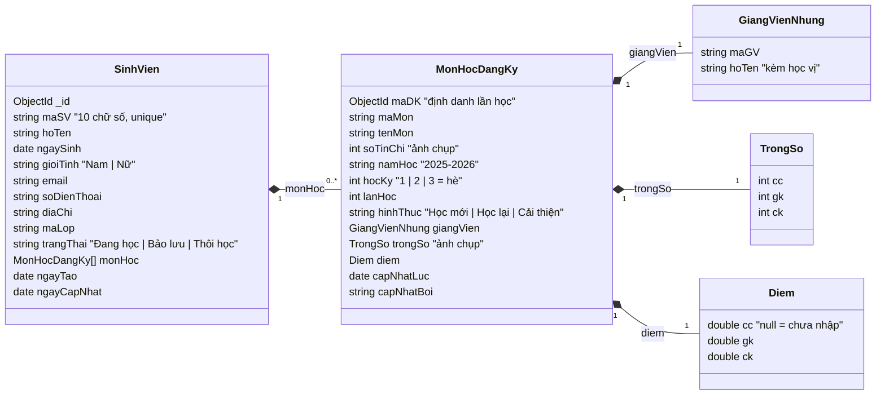
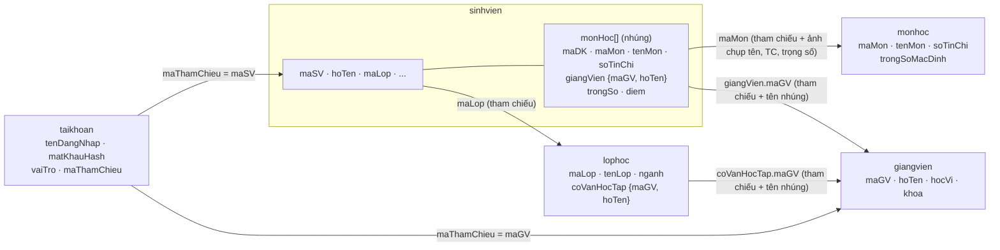

# Thiết kế cơ sở dữ liệu – EduScore

> Tài liệu báo cáo phần **Thiết kế CSDL** (barem 2.5đ) và phần **Nâng cao** (thao tác mảng, Aggregation).
> Nghiệp vụ và quy tắc tính điểm gốc: [`thiet-ke.md`](thiet-ke.md) mục 3–4. Mã nguồn tương ứng: `DT2_LMS_NHOM6/Data/DbInitializer.cs` (validator, index), `DT2_LMS_NHOM6/Pipelines/` (pipeline), `DT2_LMS_NHOM6/Services/` (lệnh ghi).

Database `eduscore` trên MongoDB 8 (standalone), 5 collection: `sinhvien`, `lophoc`, `giangvien`, `monhoc`, `taikhoan`.

**Mục lục**
1. [Vì sao chọn Document Store cho hồ sơ học tập](#1-vì-sao-chọn-document-store-cho-hồ-sơ-học-tập)
2. [Cấu trúc document và JSON Schema](#2-cấu-trúc-document-và-json-schema)
3. [Index](#3-index)
4. [Aggregation Pipeline](#4-aggregation-pipeline)
5. [Các thao tác ghi trên mảng](#5-các-thao-tác-ghi-trên-mảng)

---

## 1. Vì sao chọn Document Store cho hồ sơ học tập

### 1.1 Bài toán
Kết quả học tập của một sinh viên là một **hồ sơ lồng nhau**: sinh viên → nhiều lần học (môn, học kỳ, lần học thứ mấy, hình thức) → mỗi lần học có giảng viên, trọng số, ba điểm thành phần. Mọi màn hình chính (bảng điểm, GPA, xếp loại, nhập điểm theo lớp học phần) đều đọc **cả nhóm dữ liệu này cùng lúc**.

Thiết kế EduScore: mỗi sinh viên là **một document** trong `sinhvien`, các lần học nằm trong **mảng nhúng `monHoc`**.

### 1.2 Ưu điểm của Document Store cho bài toán này

| Ưu điểm | Thể hiện trong EduScore |
|---|---|
| **Đọc trọn hồ sơ trong một lần** | Bảng điểm S-02 / A-06 chỉ cần `find({maSV})` hoặc pipeline `BangDiem` bắt đầu bằng `$match: {maSV}` – một document, một lần đọc đĩa (qua index `ux_maSV`), không JOIN. |
| **Khớp cấu trúc nghiệp vụ** | Document trông giống "phiếu điểm" giấy: thông tin SV ở trên, danh sách môn ở dưới. Class C# `SinhVien` có `List<MonHocDangKy> MonHoc` – ánh xạ 1-1, không cần ORM phức tạp. |
| **Cập nhật nguyên tử trên một document** | MongoDB bảo đảm mỗi lệnh ghi trên **một document** là nguyên tử. Ghi danh (`$push`), nhập điểm (`$set` + `arrayFilters`) đều chỉ đụng một document `sinhvien` → không cần transaction. Kiểm tra "chưa ghi danh môn này" và lệnh `$push` nằm trong **cùng một** `updateOne` (filter có `$not: {$elemMatch}`) nên hai người bấm cùng lúc cũng không tạo bản ghi trùng. |
| **Schema linh hoạt nhưng có kiểm soát** | Document có thể thêm trường mà không cần `ALTER TABLE`; nhưng `$jsonSchema` validator (mục 2.3, `validationLevel: strict`, `validationAction: error`) chặn dữ liệu sai kiểu: `soTinChi` phải `int` 1–10, điểm `double/int/null` 0–10, `hocKy` ∈ {1,2,3}, enum tiếng Việt cho giới tính/trạng thái/hình thức… |
| **Tính toán ngay tại CSDL** | Aggregation Pipeline (`$unwind` mảng `monHoc` → quy đổi → `$group`) tính TK, GPA, xếp loại cho 100 SV trong vài mili-giây, không phải kéo dữ liệu về ứng dụng. |

### 1.3 So sánh với mô hình quan hệ

Mô hình quan hệ tương đương cần ít nhất các bảng:

```
LopHoc(maLop PK, ...)          GiangVien(maGV PK, ...)        MonHoc(maMon PK, tenMon, soTinChi, ...)
SinhVien(maSV PK, maLop FK, ...)
DangKy(maDK PK, maSV FK, maMon FK, maGV FK, namHoc, hocKy, lanHoc, hinhThuc,
       tsCC, tsGK, tsCK, diemCC, diemGK, diemCK, capNhatLuc, capNhatBoi)
```

Xem bảng điểm một SV (SQL) phải JOIN 3 bảng:
```sql
SELECT dk.*, mh.tenMon, gv.hoTen
FROM DangKy dk
JOIN MonHoc mh   ON mh.maMon = dk.maMon
JOIN GiangVien gv ON gv.maGV = dk.maGV
WHERE dk.maSV = '2001250001';
```
MongoDB: `db.sinhvien.findOne({ maSV: "2001250001" })` – tên môn, tên giảng viên đã nằm sẵn trong phần tử mảng.

| Tiêu chí | Quan hệ (SinhVien – DangKy – MonHoc) | Document (sinhvien nhúng monHoc) |
|---|---|---|
| Đọc hồ sơ + bảng điểm | JOIN 3–4 bảng, nhiều lần tìm theo khóa ngoại | 1 document |
| Ghi danh / nhập điểm | INSERT/UPDATE bảng DangKy | `$push` / `$set` + `arrayFilters` trên 1 document, nguyên tử |
| Báo cáo toàn trường | `GROUP BY` sau JOIN | `$unwind` + `$group` trong pipeline |
| Đổi tên môn / tên GV | Sửa 1 dòng (chuẩn hóa) | Phải lan truyền `updateMany` (đánh đổi – mục 1.5) |
| Ràng buộc toàn vẹn | Khóa ngoại, CHECK | Validator `$jsonSchema` + kiểm tra ở tầng service (không có khóa ngoại) |
| Transaction nhiều bảng | Có | Không dùng (standalone) – thiết kế để thao tác chính chỉ đụng 1 document |

### 1.4 Nhúng hay tham chiếu – phân tích từng quan hệ

| Quan hệ | Lựa chọn | Lý do |
|---|---|---|
| Sinh viên – Lần học (1–N) | **Nhúng** mảng `sinhvien.monHoc` | Luôn đọc cùng nhau; lần học không tồn tại độc lập ngoài SV; số phần tử có giới hạn tự nhiên (vài chục trong cả khóa học); cần cập nhật nguyên tử. |
| Lần học – Giảng viên (N–1) | **Nhúng một phần** `giangVien: {maGV, hoTen}` | `maGV` để tham chiếu và phân quyền (arrayFilters); `hoTen` (kèm học vị) để hiển thị ngay không cần tra cứu. Thông tin khác (email, khoa…) vẫn ở `giangvien`. |
| Lần học – Môn học (N–1) | **Nhúng một phần + ảnh chụp** `maMon, tenMon, soTinChi, trongSo` | `soTinChi`, `trongSo` là **ảnh chụp lúc ghi danh**: môn đổi tín chỉ/trọng số sau này không làm sai điểm các khóa trước. `tenMon` để hiển thị. |
| Lớp – Cố vấn học tập (N–1) | **Nhúng một phần** `lophoc.coVanHocTap: {maGV, hoTen}` | Hiển thị danh sách lớp không cần tra cứu GV. |
| Sinh viên – Lớp (N–1) | **Tham chiếu** `sinhvien.maLop` | Một lớp có nhiều SV; lớp có thông tin riêng (ngành, niên khóa, CVHT) và được CRUD độc lập. Sĩ số **không lưu**, luôn đếm bằng pipeline `SiSoTheoLop`. |
| Tài khoản – SV/GV (1–1) | **Tham chiếu** `taikhoan.maThamChieu` | Tách dữ liệu xác thực (hash mật khẩu, trạng thái khóa) khỏi hồ sơ; một collection duy nhất cho đăng nhập 3 vai trò. |
| Giảng viên, Môn học | **Collection riêng** | Danh mục dùng chung, CRUD độc lập. |

### 1.5 Denormalization có chủ đích và cách lan truyền

Các trường được **sao chép** để đọc nhanh, cùng cách giữ cho nhất quán:

| Trường sao chép | Nguồn | Khi nguồn đổi |
|---|---|---|
| `sinhvien.monHoc[].tenMon` | `monhoc.tenMon` | A-08 đổi tên môn → `updateMany` + `arrayFilters` sửa **mọi** phần tử có `maMon` đó (mục 5.4) |
| `sinhvien.monHoc[].giangVien.hoTen` | `giangvien.hocVi + hoTen` | A-07 đổi tên/học vị GV → `updateMany` + `arrayFilters` trên `sinhvien`, cộng `lophoc.coVanHocTap.hoTen` và `taikhoan.hoTen` |
| `lophoc.coVanHocTap.hoTen` | `giangvien` | Như trên |
| `taikhoan.hoTen` | `sinhvien.hoTen` / `giangvien` | Sửa hồ sơ → cập nhật tài khoản tương ứng |
| `sinhvien.monHoc[].soTinChi`, `trongSo` | `monhoc` | **Không lan truyền** – là ảnh chụp lúc ghi danh, đúng nghiệp vụ (A5) |

Toast sau khi đổi tên hiển thị chính lệnh `updateMany` đã chạy và số document bị sửa (ví dụ "Cập nhật tên cho N lần học").

Những gì **không lưu** (luôn tính bằng pipeline): điểm tổng kết, điểm chữ, hệ 4, đạt/không đạt, GPA, xếp loại, tín chỉ tích lũy, số môn nợ, sĩ số. Nhờ vậy sửa một điểm thành phần là mọi báo cáo tự đúng, không có dữ liệu dẫn xuất bị lệch.

### 1.6 Giới hạn 16 MB của document – vì sao không là vấn đề

- Đo trên dữ liệu mẫu: một phần tử `monHoc` ≈ **350 byte**; document `sinhvien` lớn nhất ≈ **3.2 KB** (8 lần học), trung bình ≈ 2.6 KB.
- 16 MB / 350 B ≈ **47 000 lần học** cho một sinh viên. Một chương trình đại học 4–5 năm khoảng 50–70 môn (kể cả học lại, cải thiện) → ≈ 25 KB, tức **~0.15 %** giới hạn.
- Mảng `monHoc` tăng có giới hạn tự nhiên (theo số môn của chương trình), không phải mảng "tăng vô hạn" như log hay bình luận. Vì vậy validator **không** đặt `maxItems` (giới hạn 4–8 môn chỉ áp dụng cho dữ liệu mẫu).

### 1.7 Nhược điểm và cách xử lý

| Nhược điểm | Cách xử lý trong EduScore |
|---|---|
| **Không có transaction** (MongoDB standalone không hỗ trợ multi-document transaction) | Thao tác nghiệp vụ chính (ghi danh, hủy, nhập điểm) chỉ đụng **1 document** → nguyên tử sẵn. Thao tác nhiều collection (tạo SV + tài khoản, xóa SV + tài khoản, nhập Excel danh sách SV) **ghi tuần tự, bước sau lỗi thì hoàn tác bước trước** (ví dụ `insertMany` tài khoản lỗi → xóa các SV vừa chèn theo `_id`). |
| **Trùng lặp dữ liệu** (tên môn, tên GV) | Lan truyền bằng `updateMany` + `arrayFilters` ngay khi sửa (mục 1.5); trường ảnh chụp có chủ đích thì không lan truyền. |
| **Báo cáo xuyên nhiều SV phải `$unwind`** | Dùng index multikey trên `monHoc.*` cho bước `$match` đầu pipeline; dữ liệu nhỏ (640 lần học) chạy vài ms – đo ở trang Hiệu năng (A-12). |
| **Không có khóa ngoại** | Service kiểm tra trước khi ghi: không xóa lớp còn SV, không xóa môn đã có người học, không xóa GV đang dạy / làm CVHT; mã lớp/môn/GV phải tồn tại khi ghi danh, nhập Excel. |
| **Schema tự do dễ sai kiểu** | Validator `$jsonSchema` strict cho cả 5 collection; C# map kiểu rõ ràng (`int` cho tín chỉ, `double?` cho điểm, `DateTime` UTC). |
| **Truy vấn một phần tử mảng** | Phần tử có định danh riêng `maDK` (ObjectId) → `arrayFilters: [{"e.maDK": ...}]` chỉ đúng một phần tử, không phụ thuộc vị trí trong mảng. |

---

## 2. Cấu trúc document và JSON Schema

### 2.1 Cấu trúc document `sinhvien`



Ví dụ thật (TS5, lần học INT301 ở học kỳ hiện tại – chưa có điểm CK):
```jsonc
{
  "_id": ObjectId("6ae235f4a6594dfebc9c1f16"),
  "maSV": "2001250005", "hoTen": "Võ Ngọc Bảo Anh",
  "ngaySinh": ISODate("2007-05-28T00:00:00Z"), "gioiTinh": "Nữ",
  "email": "2001250005@sv.eduscore.vn", "soDienThoai": "0988678905", "diaChi": "Thủ Đức, TP.HCM",
  "maLop": "16DHTH01", "trangThai": "Đang học",
  "monHoc": [
    // ... 4 lần học HK1, HK2 2025-2026 ...
    { "maDK": ObjectId("6ae235eca6594dfebc9c1c91"),
      "maMon": "INT301", "tenMon": "Cơ sở dữ liệu NoSQL", "soTinChi": 3,
      "namHoc": "2026-2027", "hocKy": 1, "lanHoc": 1, "hinhThuc": "Học mới",
      "giangVien": { "maGV": "GV005", "hoTen": "ThS. Trần Văn Bình" },
      "trongSo": { "cc": 10, "gk": 30, "ck": 60 },
      "diem": { "cc": 10.0, "gk": 9.0, "ck": null },
      "capNhatLuc": ISODate("2026-10-20T03:00:00Z"), "capNhatBoi": "GV005" }
  ],
  "ngayTao": ISODate("..."), "ngayCapNhat": ISODate("...")
}
```

### 2.2 Quan hệ giữa 5 collection



Mũi tên = tham chiếu bằng mã nghiệp vụ (không dùng `_id`); "tên nhúng" = trường được sao chép và lan truyền khi nguồn đổi (mục 1.5).

### 2.3 JSON Schema đầy đủ của `sinhvien`

Tạo bằng lệnh `create` (collection chưa có) hoặc `collMod` (đã có) lúc ứng dụng khởi động – `Data/DbInitializer.cs`:

```js
db.runCommand({
  collMod: "sinhvien",            // hoặc create: "sinhvien"
  validationLevel: "strict",      // áp dụng cho mọi insert / update
  validationAction: "error",      // vi phạm → từ chối ghi
  validator: { $jsonSchema: {
    bsonType: "object",
    required: ["maSV","hoTen","ngaySinh","gioiTinh","maLop","trangThai","monHoc"],
    properties: {
      maSV:        { bsonType: "string", pattern: "^[0-9]{10}$" },
      hoTen:       { bsonType: "string", minLength: 2, maxLength: 100 },
      ngaySinh:    { bsonType: "date" },
      gioiTinh:    { enum: ["Nam","Nữ"] },
      email:       { bsonType: ["string","null"] },
      soDienThoai: { bsonType: ["string","null"] },
      diaChi:      { bsonType: ["string","null"] },
      maLop:       { bsonType: "string" },
      trangThai:   { enum: ["Đang học","Bảo lưu","Thôi học"] },
      monHoc: { bsonType: "array", items: {          // KHÔNG đặt maxItems
        bsonType: "object",
        required: ["maDK","maMon","tenMon","soTinChi","namHoc","hocKy","lanHoc","hinhThuc","giangVien","trongSo","diem"],
        properties: {
          maDK:     { bsonType: "objectId" },
          maMon:    { bsonType: "string" },
          tenMon:   { bsonType: "string" },
          soTinChi: { bsonType: "int", minimum: 1, maximum: 10 },
          namHoc:   { bsonType: "string", pattern: "^[0-9]{4}-[0-9]{4}$" },
          hocKy:    { bsonType: "int", enum: [1,2,3] },
          lanHoc:   { bsonType: "int", minimum: 1 },
          hinhThuc: { enum: ["Học mới","Học lại","Cải thiện"] },
          giangVien: { bsonType: "object", required: ["maGV","hoTen"],
                       properties: { maGV: { bsonType: "string" }, hoTen: { bsonType: "string" } } },
          trongSo: { bsonType: "object", required: ["cc","gk","ck"], properties: {
                       cc: { bsonType: "int", minimum: 0, maximum: 100 },
                       gk: { bsonType: "int", minimum: 0, maximum: 100 },
                       ck: { bsonType: "int", minimum: 0, maximum: 100 } } },
          diem: { bsonType: "object", required: ["cc","gk","ck"], properties: {
                       cc: { bsonType: ["double","int","null"], minimum: 0, maximum: 10 },
                       gk: { bsonType: ["double","int","null"], minimum: 0, maximum: 10 },
                       ck: { bsonType: ["double","int","null"], minimum: 0, maximum: 10 } } },
          capNhatLuc: { bsonType: ["date","null"] },
          capNhatBoi: { bsonType: ["string","null"] }
        } } }
    } } }
})
```

Điểm đáng chú ý:
- **Tín chỉ, học kỳ, trọng số là `int`** – chặn trường hợp ghi `3.0` (double) hay `"3"` (chuỗi).
- **Điểm cho phép `null`** = chưa nhập; `diem` luôn có đủ 3 khóa `cc, gk, ck` (required) để pipeline không phải đoán trường thiếu.
- Ràng buộc "tổng trọng số = 100", "tối đa 1 chữ số thập phân" kiểm tra ở tầng service/form (JSON Schema không biểu diễn được tổng giữa các trường).

Thử vi phạm trong mongosh:
```js
db.sinhvien.updateOne({ maSV: "2001250001" }, { $set: { "monHoc.0.diem.cc": 11 } })
// MongoServerError: Document failed validation  (maximum: 10)
```

Các collection còn lại có validator đơn giản (required + kiểu + enum):

| Collection | required | Ràng buộc chính |
|---|---|---|
| `lophoc` | maLop, tenLop, nienKhoa, nganh, khoa | `nienKhoa` dạng `^[0-9]{4}-[0-9]{4}$`; `coVanHocTap` object `{maGV, hoTen}` hoặc null |
| `giangvien` | maGV, hoTen, hocVi, khoa | `hocVi` ∈ CN., ThS., TS., PGS.TS. |
| `monhoc` | maMon, tenMon, soTinChi, trongSoMacDinh | `soTinChi` int 1–10; trọng số int 0–100 |
| `taikhoan` | tenDangNhap, matKhauHash, vaiTro, maThamChieu, hoTen, trangThai | `vaiTro` ∈ Admin, GiangVien, SinhVien; `trangThai` ∈ Hoạt động, Khóa |

---

## 3. Index

Tạo lúc khởi động (`DbInitializer.TaoIndexAsync`), đặt tên `ux_*` (unique) / `ix_*`:

| Collection | Index | Tên | Phục vụ |
|---|---|---|---|
| `sinhvien` | `{maSV: 1}` unique | `ux_maSV` | Mọi thao tác theo MSSV: hồ sơ, bảng điểm, `updateOne` ghi danh / nhập điểm; chống trùng MSSV |
| `sinhvien` | `{maLop: 1}` | `ix_maLop` | Danh sách / báo cáo theo lớp (A-03, A-04 lọc lớp, ghi danh cả lớp), chặn xóa lớp còn SV |
| `sinhvien` | `{"monHoc.giangVien.maGV": 1, "monHoc.namHoc": 1, "monHoc.hocKy": 1}` | `ix_monHoc_maGV_namHoc_hocKy` | **Multikey** trên mảng: lớp học phần của GV theo học kỳ (G-01, G-02, G-04), danh sách nhập điểm G-03 |
| `sinhvien` | `{"monHoc.maMon": 1}` | `ix_monHoc_maMon` | Multikey: lan truyền tên môn (`updateMany` theo `monHoc.maMon`), đếm lần học của môn, chặn xóa môn đã có người học |
| `sinhvien` | `{hoTen: 1}` | `ix_hoTen` | Sắp xếp / tìm theo họ tên ở A-04 |
| `lophoc` | `{maLop: 1}` unique | `ux_maLop` | Tra cứu + chống trùng mã lớp |
| `giangvien` | `{maGV: 1}` unique | `ux_maGV` | Tra cứu + chống trùng mã GV |
| `monhoc` | `{maMon: 1}` unique | `ux_maMon` | Tra cứu + chống trùng mã môn |
| `taikhoan` | `{tenDangNhap: 1}` unique | `ux_tenDangNhap` | Đăng nhập; chống trùng tên đăng nhập |
| `taikhoan` | `{vaiTro: 1, maThamChieu: 1}` | `ix_vaiTro_maThamChieu` | Tìm tài khoản của một SV/GV (reset mật khẩu, khóa, lan truyền tên, xóa kèm hồ sơ) |

Index multikey: MongoDB tạo một khóa index cho **mỗi phần tử** của mảng `monHoc`, nên truy vấn `{"monHoc.giangVien.maGV": "GV005", ...}` hay `$elemMatch` trên mảng vẫn dùng index. Trang **Hiệu năng (A-12)** chạy `explain("executionStats")` cho cùng truy vấn có index và ép không index (`hint: {$natural: 1}`) để so sánh `IXSCAN` với `COLLSCAN`, `totalDocsExamined`, thời gian.

---

## 4. Aggregation Pipeline

Mọi phép tính điểm nằm trong pipeline (thiết kế mục 3); C# chỉ hiển thị kết quả. Pipeline viết bằng chuỗi JSON trong `DT2_LMS_NHOM6/Pipelines/*.cs`, có tham số; bản JSON chạy được nằm ở `database/pipelines/*.json` (sinh bằng `--export-pipelines`, hướng dẫn dán vào Compass: [`database/pipelines/README.md`](../database/pipelines/README.md)).

### 4.1 Bộ stage quy đổi dùng chung (`QuyDoiDiemStages`)

Đặt ngay sau `{ $unwind: "$monHoc" }`; viết **một lần**, mọi pipeline chèn lại qua chỗ giữ `"@quyDoi"`:

| Stage | Tính | Toán tử |
|---|---|---|
| 1 | `monHoc.duDiem` = cả 3 điểm khác null | `$and`, `$ne`, `$ifNull` |
| 2 | `monHoc.diemTK` = `floor((cc·tsCC + gk·tsGK + ck·tsCK)/10 + 0.5000001) / 10`, chưa đủ điểm → null | `$cond`, `$floor`, `$multiply`, `$divide` |
| 3 | `monHoc.diemChu` A/B/C/D/F theo ngưỡng 8.5 / 7.0 / 5.5 / 4.0 | `$switch` |
| 4 | `monHoc.diemHe4` 4/3/2/1/0 và `monHoc.dat` (TK ≥ 4.0) | `$switch`, `$cond` |

**Vì sao không dùng `$round`:** `$round` của MongoDB làm tròn kiểu banker's (về số chẵn): TS1 môn INT101 có tổng 845 → 84.5 → `$round` cho 84 → **8.4 (B)**, sai; đúng quy chế là **8.5 (A)**. Công thức `floor(x + 0.5000001)` làm tròn nửa lên; hằng `0.0000001` chống sai số dấu phẩy động (ví dụ 84.49999999).

Cặp stage `"@gpaXepLoai"` (dùng sau `$group`): `gpa = floor(tongDiemTC / tongTinChiGpa × 100 + 0.5000001) / 100` (không có tín chỉ → null, `$cond` tránh chia 0), rồi `xepLoai` bằng `$switch` theo **GPA đã làm tròn** (≥ 3.6 Xuất sắc, ≥ 3.2 Giỏi, ≥ 2.5 Khá, ≥ 2.0 Trung bình, ≥ 1.0 Yếu, còn lại Kém, null → Chưa xếp loại).

### 4.2 Các pipeline

| Pipeline | Dùng ở | Các bước chính |
|---|---|---|
| `BangDiem` (maSV) | S-02, A-06, nhận diện hình thức khi ghi danh, API | `$match {maSV}` → `$unwind` → quy đổi → `$setWindowFields` (partition theo maMon, sort hệ 4 ↓, TK ↓, năm học ↓, học kỳ ↓, lấy `$first` maDK = **lần học tốt nhất**) → `$project` + `tinhTichLuy` = (là lần tốt nhất **và** đạt) → `$sort` |
| `GpaHocKy` (bộ lọc SV) | S-01 biểu đồ, S-02 cuối khối học kỳ | `$unwind` → quy đổi → `$group` theo (maSV, namHoc, hocKy): TC đăng ký, TC đạt, Σ(hệ4×TC) và ΣTC của mọi lần **đủ điểm, kể cả F** → `@gpaXepLoai` → `$project` |
| `BaoCaoHocLuc` (bộ lọc, phạm vi) | A-10, G-04, A-03, A-04, S-01 | `$match` bộ lọc → `$filter` lần học theo phạm vi → `$unwind` (**preserveNullAndEmptyArrays: true** – SV chưa học vẫn có dòng "Chưa xếp loại") → quy đổi → `$sort` + `$group` (maSV, maMon) lấy `$first` = lần tốt nhất → `$group` theo SV cộng dồn bằng `$cond` (tongDiemTC, tongTinChiGpa, tinChiTichLuy, soMonNo) → `@gpaXepLoai` → `$project` |
| `ThongKeXepLoai` | Thẻ số + biểu đồ A-10, G-04, A-01, A-03 | `BaoCaoHocLuc` + `$group` (xếp loại, lớp) → `$group` xếp loại kèm `$push` theo lớp → `$switch` thứ tự hiển thị |
| `GpaTheoLop` | Biểu đồ A-01 | `BaoCaoHocLuc` + `$group` theo maLop (`$avg` gpa, sĩ số) → làm tròn floor |
| `LopHocPhanCuaGV` (maGV, học kỳ) | G-01, G-02 | `$match` `$elemMatch` → `$unwind` → `$match` đúng GV/học kỳ → quy đổi → `$group` (maMon, namHoc, hocKy): sĩ số, số đủ điểm (`$cond`), `$addToSet` các lớp |
| `DanhSachNhapDiem` (maGV, maMon, học kỳ) | G-03, mẫu/xuất Excel bảng điểm | `$match` `$elemMatch` → `$unwind` → `$match` → quy đổi → `$project` (kèm `maDK` để lưu bằng arrayFilters) |
| `SiSoTheoLop`, `SoLanHocTheoMon`, `HocKyCoDuLieu`, `LopHocPhanToanTruong` | A-02, A-08, ô chọn học kỳ A-10, ô chọn lớp học phần A-11 | Pipeline đếm / liệt kê nhỏ (`$group`, `$project`) |

**Hai phạm vi của `BaoCaoHocLuc`** (cùng một pipeline, khác tham số):

| | Tích lũy | Một học kỳ |
|---|---|---|
| `$filter` lần học | giữ hết | chỉ lần học có (namHoc, hocKy) đó |
| Lần được tính GPA (`@dieuKienTinhGpa`) | lần tốt nhất **đạt** (`dat = true`) | mọi lần **đủ điểm**, kể cả F (`duDiem = true`) |
| Cột TC | tín chỉ tích lũy | TC đạt trong kỳ |
| Cột số môn | số môn nợ (lần tốt nhất vẫn F) | số môn F trong kỳ |

Ví dụ đọc kết quả (TS3, môn MAT101): lần 1 C (5.7), lần 2 cải thiện được D (4.7). Sau `$sort` hệ 4 giảm dần, `$group` + `$first` chọn lần 1 → GPA tích lũy giữ điểm C, đúng quy chế "cải thiện bị thấp hơn thì giữ lần cũ".

Kiểm chứng: lệnh `--kiem-thu-gpa` chạy các pipeline thật cho 5 SV kiểm thử và so với bảng tính tay – **200/200 tiêu chí PASS** ([`kiem-thu-gpa.md`](kiem-thu-gpa.md)).

Chạy thử trong mongosh:
```js
db.sinhvien.aggregate(EJSON.parse(fs.readFileSync("database/pipelines/BaoCaoHocLuc.json", "utf8")))
```

---

## 5. Các thao tác ghi trên mảng

Mọi lệnh được dựng bằng `BsonDocument` tường minh trong `Services/`, và **chính document đó** được in ra dạng mongosh (`MongoCommandFormatter`) để hiện trong toast "Lệnh MongoDB đã chạy" kèm `matchedCount` / `modifiedCount`. Các `ObjectId` của TS5 dưới đây khớp bản xuất `database/export/` / `database/dump/`; sau `--reset` thì `_id`, `maDK` sinh mới (nội dung không đổi) – lấy `maDK` thật trong Compass hoặc trong toast.

### 5.1 `$push` – Ghi danh (A-09, API `POST /api/sinhvien/{maSV}/monhoc`)
Thêm một phần tử mới (điểm toàn `null`) vào cuối mảng `monHoc`. Ghi danh cả lớp = `bulkWrite` nhiều `updateOne`, `ordered: false`.
```js
db.sinhvien.updateOne(
  { maSV: "2001250006",
    // chống ghi trùng: chỉ khớp khi SV CHƯA có lần học cùng môn, cùng học kỳ
    monHoc: { $not: { $elemMatch: { maMon: "INT203", namHoc: "2026-2027", hocKy: 1 } } } },
  { $push: { monHoc: {
        maDK: ObjectId("6720f1a2b3c4d5e6f7a8b9c0"), maMon: "INT203", tenMon: "Mạng máy tính", soTinChi: 3,
        namHoc: "2026-2027", hocKy: 1, lanHoc: 1, hinhThuc: "Học mới",
        giangVien: { maGV: "GV007", hoTen: "ThS. Huỳnh Gia Bảo" },
        trongSo: { cc: 10, gk: 30, ck: 60 },
        diem: { cc: null, gk: null, ck: null }, capNhatLuc: null, capNhatBoi: null } },
    $set: { ngayCapNhat: ISODate() } })
```
`lanHoc` và `hinhThuc` (Học mới / Học lại / Cải thiện) được xác định từ kết quả pipeline `BangDiem` của SV (các lần học trước cùng `maMon` đã đạt chưa), không tính lại điểm bằng C#.

### 5.2 `$pull` – Hủy ghi danh (A-06)
Chỉ xóa được phần tử **chưa có điểm nào** – điều kiện nằm trong filter nên kiểm tra và xóa là một thao tác nguyên tử:
```js
db.sinhvien.updateOne(
  { maSV: "2001250006",
    monHoc: { $elemMatch: { maDK: ObjectId("6720f1a2b3c4d5e6f7a8b9c0"),
                            "diem.cc": null, "diem.gk": null, "diem.ck": null } } },
  { $pull: { monHoc: { maDK: ObjectId("6720f1a2b3c4d5e6f7a8b9c0") } },
    $set: { ngayCapNhat: ISODate() } })
// matchedCount = 0 → "Đã có điểm, không thể hủy"
```

### 5.3 `$set` + `arrayFilters` – Nhập điểm (G-03, nhập Excel, API `PUT .../diem`)
```js
db.sinhvien.updateOne(
  { maSV: "2001250005",
    monHoc: { $elemMatch: { maDK: ObjectId("6ae235eca6594dfebc9c1c91"), "giangVien.maGV": "GV005" } } },
  { $set: { "monHoc.$[e].diem.ck": 8.5,
            "monHoc.$[e].capNhatLuc": ISODate(), "monHoc.$[e].capNhatBoi": "GV005",
            ngayCapNhat: ISODate() } },
  { arrayFilters: [ { "e.maDK": ObjectId("6ae235eca6594dfebc9c1c91"), "e.giangVien.maGV": "GV005" } ] })
```
- `$[e]` là **filtered positional operator**: chỉ các phần tử thỏa điều kiện của `e` trong `arrayFilters` bị sửa. `maDK` xác định đúng một lần học, không phụ thuộc vị trí trong mảng.
- **Quyền của giảng viên nằm ngay trong câu lệnh**: `e.giangVien.maGV` = mã GV lấy từ claim đăng nhập. GV khác gửi `maDK` của lớp không phải mình dạy → không phần tử nào khớp → `modifiedCount = 0` → báo "Không có quyền hoặc không tìm thấy lần học".
- Điều kiện được lặp ở filter (`$elemMatch`) để khi không có quyền thì cả document không khớp (nếu chỉ có arrayFilters, `ngayCapNhat` vẫn bị ghi).
- Chỉ `$set` thành phần có giá trị mới; xóa điểm nhập nhầm = `$set` về `null`. Admin nhập qua Excel thì bỏ điều kiện `maGV`, `capNhatBoi: "admin"`.
- "Lưu tất cả" và nhập Excel dùng `bulkWrite` nhiều `updateOne` như trên.

Kết quả TS5 sau lệnh trên: TK = floor((10×10 + 9×30 + 8.5×60)/10 + 0.5000001)/10 = floor(88.5000001)/10 = **8.8 (A)** – pipeline tự tính lại khi tải trang.

### 5.4 `updateMany` + `arrayFilters` – Lan truyền tên (A-08, A-07)
Đổi tên môn: sửa **mọi** phần tử có `maMon` đó trong **mọi** document (kể cả học lại, cải thiện):
```js
db.sinhvien.updateMany(
  { "monHoc.maMon": "INT301" },                       // dùng index ix_monHoc_maMon
  { $set: { "monHoc.$[e].tenMon": "Cơ sở dữ liệu NoSQL nâng cao" } },
  { arrayFilters: [ { "e.maMon": "INT301" } ] })
```
Đổi tên / học vị giảng viên: 3 lệnh tuần tự
```js
db.sinhvien.updateMany({ "monHoc.giangVien.maGV": "GV005" },
  { $set: { "monHoc.$[e].giangVien.hoTen": "TS. Trần Văn Bình" } },
  { arrayFilters: [ { "e.giangVien.maGV": "GV005" } ] })
db.lophoc.updateMany({ "coVanHocTap.maGV": "GV005" }, { $set: { "coVanHocTap.hoTen": "TS. Trần Văn Bình" } })
db.taikhoan.updateOne({ vaiTro: "GiangVien", maThamChieu: "GV005" }, { $set: { hoTen: "TS. Trần Văn Bình" } })
```
So với toán tử vị trí `$` (chỉ sửa phần tử **đầu tiên** khớp) và `$[]` (sửa **tất cả** phần tử), `$[e]` + `arrayFilters` sửa **đúng các phần tử thỏa điều kiện** – phù hợp khi một SV có nhiều lần học cùng môn.

### 5.5 Tóm tắt toán tử mảng

| Toán tử | Nghiệp vụ | Màn hình |
|---|---|---|
| `$push` | Ghi danh (thêm lần học) | A-09 Ghi danh, API |
| `$pull` | Hủy ghi danh (lần học chưa có điểm) | A-06 Hồ sơ SV |
| `$set` + `$[e]` + `arrayFilters` | Nhập / sửa / xóa điểm thành phần, quyền GV trong arrayFilters | G-03 Nhập điểm, A-11 / G-03 Nhập Excel, API |
| `updateMany` + `arrayFilters` | Lan truyền tên môn, tên giảng viên | A-08 Môn học, A-07 Giảng viên |
| `$elemMatch` (trong filter) | Chống ghi danh trùng, chỉ hủy khi chưa có điểm, kiểm tra quyền | Các lệnh trên |
| `bulkWrite` | Ghi danh cả lớp, lưu tất cả điểm, nhập Excel | A-09, G-03, A-11 |
